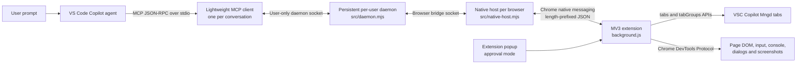
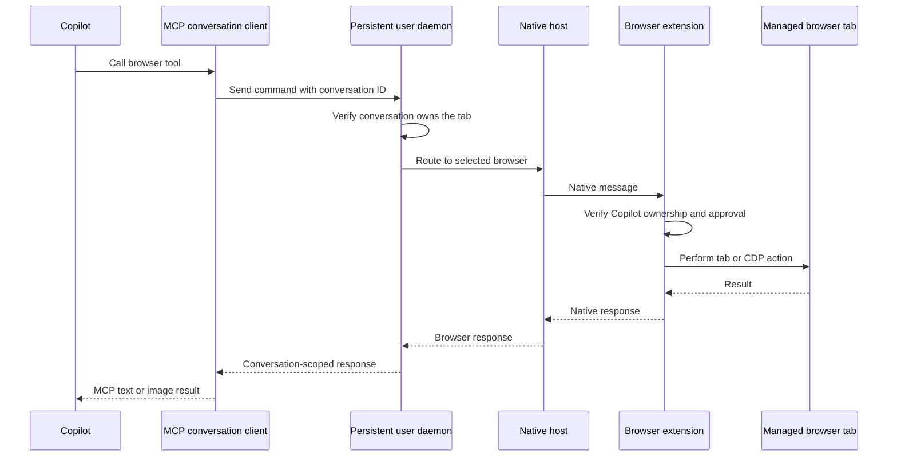

# Copilot browser interaction

Local MCP bridge that lets VS Code Copilot browse and run E2E checks in the user's real Chrome or Edge profile.

Copilot can open, group, list, close, navigate, read, screenshot, click, type, press keys, hover, drag, select, scroll, wait, handle dialogs, highlight text, inspect console messages, and resize the viewport. User-opened tabs remain inaccessible until explicitly shared from the extension popup.

Every Copilot-created tab is placed in the `VSC Copilot Mngd` browser group.

## Features

| Area | Capabilities |
| --- | --- |
| Real browser profiles | Uses the user's existing Chrome and Edge profiles, cookies, and signed-in sessions |
| Multi-browser routing | Keeps Chrome and Edge connected simultaneously and targets either browser explicitly |
| Persistent runtime | One detached per-user daemon is shared by all local VS Code workspaces, profiles, windows, and conversations |
| Conversation isolation | Explicit session tokens keep each conversation's tabs, groups, actions, and cleanup separate |
| Managed tabs | Opens, lists, groups, navigates, reloads, goes back/forward, and closes Copilot-owned tabs |
| Manual sharing | Adopts a user-opened HTTP(S) tab only after **Share this tab with Copilot** is selected |
| Approval controls | Per-site, per-tab, or opt-in automatic approval for tabs opened by Copilot |
| Page interaction | Reads text and elements; clicks, types, presses keys, hovers, drags, selects, scrolls, and waits |
| E2E diagnostics | Captures screenshots, console errors, dialogs, responsive viewports, and highlighted text |
| Session cleanup | Detaches browser debugging and clears transient state without closing managed tabs |
| Portability | User-level installers for macOS, Linux, and Windows; no administrator access required |

## How it works





1. VS Code automatically starts a lightweight MCP stdio client for each conversation.
2. The first client starts one detached per-user daemon; later conversations, workspaces, profiles, and VS Code windows reuse it.
3. The daemon owns browser connections, managed-tab routing, and per-conversation ownership through user-only local sockets.
4. Chrome and Edge each start their own native host and stay connected independently to the daemon.
5. The extension persists each tab's conversation owner and enforces the configured approval mode before every page operation.
6. Normal tab APIs handle creation, grouping, navigation, and history. Chrome DevTools Protocol handles user-like input, screenshots, console capture, dialogs, and viewport emulation.

## Install on another machine

Keep the project in a stable path. Moving it later requires rerunning the install commands.

### macOS

1. Install Node.js 20+, VS Code, and Chrome or Edge.
2. Copy or clone this project.
3. From the project folder, run:

   ```bash
   npm run install-host
   ```

4. Open `chrome://extensions` or `edge://extensions`.
5. Enable **Developer mode**, choose **Load unpacked**, and select the `extension` folder.
6. Restart the browser.
7. Configure VS Code using one of the scopes below.

The installer writes user-level native-host manifests for both Chrome and Edge. It does not require administrator access.

### Windows

1. Install Node.js 20+, VS Code, and Chrome or Edge.
2. Copy or clone this project to a stable path.
3. Open PowerShell in the project folder and run:

   ```powershell
   npm run install-host
   ```

4. Open `chrome://extensions` or `edge://extensions`.
5. Enable **Developer mode**, choose **Load unpacked**, and select the `extension` folder.
6. Restart the browser.
7. Configure VS Code using one of the scopes below.

The installer creates a CMD launcher and registers the Chrome and Edge native hosts under `HKCU`, so administrator access is not required.

## VS Code workspace scope

### Current project only

The committed `.vscode/mcp.json` makes the server available only while this project is the open workspace. Start it with **MCP: List Servers** and trust `copilot-browser-interaction`.

### All local workspaces

Run:

```bash
npm run configure-vscode
```

This adds the server to the default and built-in **Agents** profiles, making it available to every local workspace. Set this in User Settings to start configured MCP servers automatically:

```json
{
  "chat.mcp.autoStart": true
}
```

It does not install into:

- additional custom VS Code profiles
- another user account or computer
- remote SSH, WSL, or Dev Container hosts

For an additional custom profile, run `code --profile "Profile Name" --add-mcp '<configuration>'`, or switch to that profile and run **MCP: Add Server** with **Global** selected. Use:

```json
{
  "name": "copilot-browser-interaction",
  "type": "stdio",
  "command": "/absolute/path/to/node",
  "args": ["/absolute/path/to/copilot-extension/src/mcp.mjs"]
}
```

All local VS Code windows and profiles reuse one daemon for the current OS user. Individual MCP processes can start and stop without disconnecting Chrome or Edge.

## Run

1. Trust `copilot-browser-interaction` once from **MCP: List Servers**. With `chat.mcp.autoStart` enabled, VS Code starts it automatically afterward.
2. Ask Copilot to open a page or perform an E2E task. Name **Chrome** or **Edge** when both are running.
3. On the created tab, open the extension popup and grant access.
4. Copilot can then interact with that managed tab.

### Share an existing tab

To investigate a page you opened manually:

1. Open the extension popup on that HTTP(S) tab.
2. Choose the approval mode.
3. Select **Share this tab with Copilot**.

The tab becomes Copilot-owned, receives the selected approval, and moves into `VSC Copilot Mngd`. Select **Stop sharing** to revoke ownership, detach debugging, remove it from the managed group, and hide it from Copilot again.

### Automatic approval

Enable **Automatically allow tabs opened by Copilot** in the extension popup to let new Copilot-created tabs continue without pausing for approval. This setting:

- applies only to tabs created by Copilot
- persists across navigation within those tabs
- does not auto-approve manually shared tabs
- can be disabled at any time to restore per-site or per-tab approval prompts

When automatic approval is disabled, Copilot reports the missing access and waits for you to approve it from the popup before retrying.

### End a browser session

After browser or E2E work, Copilot calls `end_browser_session`. It:

- detaches Chrome DevTools Protocol from managed tabs
- removes the browser-wide debugging notice
- clears captured console and dialog state
- leaves managed tabs open and keeps their ownership and approvals

The next browser action attaches again when needed.

Chrome and Edge can stay connected simultaneously. New-tab calls target the named browser, and every returned tab carries its browser identity so later actions stay routed correctly.
Actions are serialized within each browser to prevent parallel input calls from fighting over focus, while Chrome and Edge can still execute independently.

### Conversation isolation

Each conversation calls `start_browser_session` and receives an unguessable session token that every later browser tool requires:

- tabs opened by one conversation are hidden from every other conversation
- a guessed tab ID is rejected unless that conversation owns it
- each conversation gets a separate browser tab group named `VSC Copilot Mngd`
- actions are serialized per browser to prevent input races
- ending one conversation detaches only its debugger sessions
- the persistent daemon and other conversations continue running

A manually shared tab starts unassigned and is claimed by the first Copilot conversation that lists it. `end_browser_session` invalidates only that conversation's token.

## Approval modes

Choose the mode in the extension popup:

- **Per site (default):** approve each website origin. Navigating to another site requires approval there.
- **Per Copilot tab:** approve the Copilot-owned tab once. That tab remains approved when it navigates to other websites until the browser session ends or access is revoked.

The per-tab mode uses Chrome DevTools Protocol, so the browser displays its standard debugging notice while a tab is attached.

## Performance

Approval and mode settings are cached in memory inside the extension and kept correct via `chrome.storage.onChanged`, so routine actions (click, type, read, screenshot, etc.) do zero or one Chrome storage round-trip instead of up to five. Site permission checks stay live and uncached since they're security-sensitive.

Measured warm-call latency through the full stack (MCP client → daemon → native host → extension → Chrome DevTools Protocol): `read_browser_tab` ~2.4ms avg, `click_browser_element` ~2.0ms avg, `type_in_browser_element` ~3.8ms avg, `list_browser_tabs` ~0.8ms avg. This is dominated by Chrome's own CDP command processing, not by local IPC (a bare local-socket round trip on the same hardware costs ~0.02ms), so this is close to the practical floor for browser automation through this protocol.

If the MCP client's daemon connection drops (for example, another conversation triggers a version-mismatch daemon restart), the client transparently reconnects and resumes on its next call instead of failing permanently.

## Security boundary

Tab ownership and approvals are checked inside the browser extension for every page operation. The MCP cannot adopt a user tab itself; sharing requires an explicit click in the extension popup. The bridge uses a user-only local socket. Page data goes only to the local Copilot MCP client unless Copilot sends it elsewhere under the configured service's data policy.
