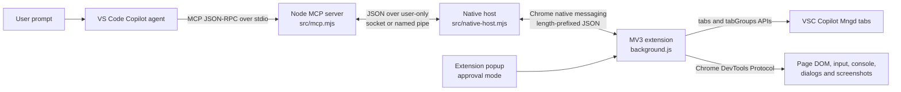
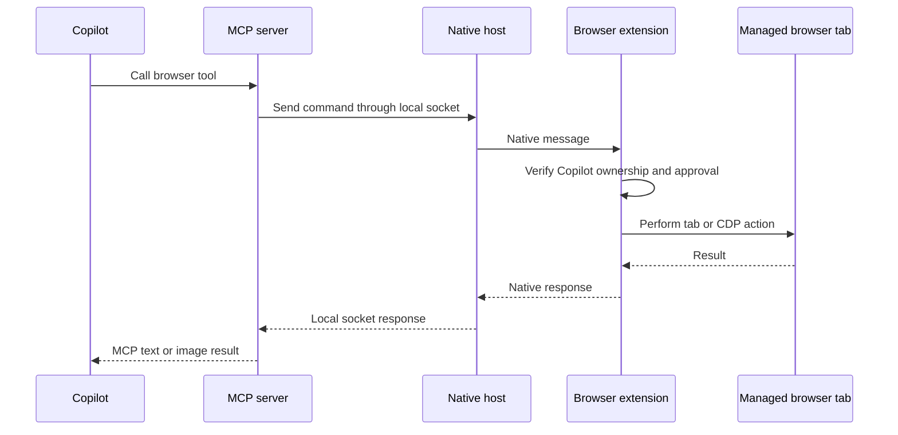

# Copilot browser interaction

Local MCP bridge that lets VS Code Copilot browse and run E2E checks in the user's real Chrome or Edge profile.

Copilot can open, group, list, close, navigate, read, screenshot, click, type, press keys, hover, drag, select, scroll, wait, handle dialogs, highlight text, inspect console messages, and resize the viewport. It cannot access tabs opened by the user or another extension.

Every Copilot-created tab is placed in the `VSC Copilot Mngd` browser group.

## How it works





1. VS Code starts the MCP server as a local stdio process.
2. The MCP server creates a user-only Unix socket on macOS/Linux or named pipe on Windows.
3. Chrome or Edge starts the registered native host. The host connects the extension to that local MCP socket.
4. The extension enforces tab ownership and the configured approval mode before every page operation.
5. Normal tab APIs handle creation, grouping, navigation, and history. Chrome DevTools Protocol handles user-like input, screenshots, console capture, dialogs, and viewport emulation.

## Install on another machine

Keep the project in a stable path. Moving it later requires rerunning the install commands.

### macOS

1. Install Node.js 20+, VS Code, and Chrome or Edge.
2. Copy or clone this project.
3. From the project folder, run:

   ```bash
   npm run install-host
   ```

4. Open `chrome://extensions` or `edge://extensions`.
5. Enable **Developer mode**, choose **Load unpacked**, and select the `extension` folder.
6. Restart the browser.
7. Configure VS Code using one of the scopes below.

The installer writes user-level native-host manifests for both Chrome and Edge. It does not require administrator access.

### Windows

1. Install Node.js 20+, VS Code, and Chrome or Edge.
2. Copy or clone this project to a stable path.
3. Open PowerShell in the project folder and run:

   ```powershell
   npm run install-host
   ```

4. Open `chrome://extensions` or `edge://extensions`.
5. Enable **Developer mode**, choose **Load unpacked**, and select the `extension` folder.
6. Restart the browser.
7. Configure VS Code using one of the scopes below.

The installer creates a CMD launcher and registers the Chrome and Edge native hosts under `HKCU`, so administrator access is not required.

## VS Code workspace scope

### Current project only

The committed `.vscode/mcp.json` makes the server available only while this project is the open workspace. Start it with **MCP: List Servers** and trust `copilot-browser-interaction`.

### All local workspaces

Run:

```bash
npm run configure-vscode
```

This adds the server to the default and built-in **Agents** profiles, making it available to every local workspace. Set this in User Settings to start configured MCP servers automatically:

```json
{
  "chat.mcp.autoStart": true
}
```

It does not install into:

- additional custom VS Code profiles
- another user account or computer
- remote SSH, WSL, or Dev Container hosts

For an additional custom profile, run `code --profile "Profile Name" --add-mcp '<configuration>'`, or switch to that profile and run **MCP: Add Server** with **Global** selected. Use:

```json
{
  "name": "copilot-browser-interaction",
  "type": "stdio",
  "command": "/absolute/path/to/node",
  "args": ["/absolute/path/to/copilot-extension/src/mcp.mjs"]
}
```

Only one MCP server instance can own the browser bridge at a time. When switching between simultaneously open VS Code windows, stop it in the first window before starting it in another.

## Run

1. Trust `copilot-browser-interaction` once from **MCP: List Servers**. With `chat.mcp.autoStart` enabled, VS Code starts it automatically afterward.
2. Ask Copilot to open a page or perform an E2E task.
3. On the created tab, open the extension popup and grant access.
4. Copilot can then interact with that managed tab.

## Approval modes

Choose the mode in the extension popup:

- **Per site (default):** approve each website origin. Navigating to another site requires approval there.
- **Per Copilot tab:** approve the Copilot-owned tab once. That tab remains approved when it navigates to other websites until the browser session ends or access is revoked.

The per-tab mode uses Chrome DevTools Protocol, so the browser displays its standard debugging notice while a tab is attached.

## Security boundary

Tab ownership and approvals are checked inside the browser extension for every page operation. The bridge uses a user-only local socket. Page data goes only to the local Copilot MCP client unless Copilot sends it elsewhere under the configured service's data policy.
